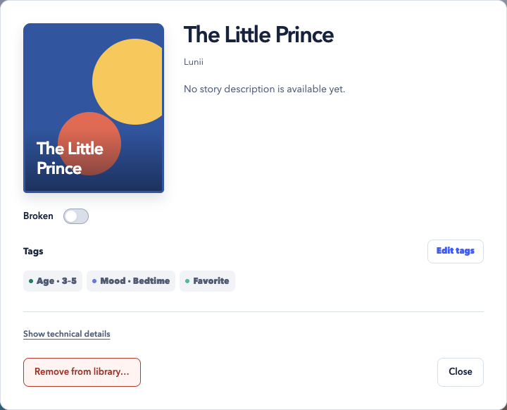
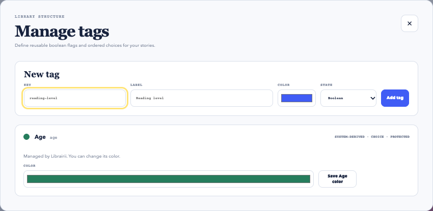

<p align="center">
  
</p>

<h1 align="center">Librairii</h1>

<p align="center">
  <strong>Your stories, beautifully shelved.</strong><br>
  A local-first desktop library for your Lunii story archives.
</p>

<p align="center">
  <a href="https://github.com/01max/librairii/releases/latest"></a>
  <a href="https://github.com/01max/librairii/actions/workflows/ci.yml"></a>
  <a href="docs/release-platforms.md"></a>
</p>

<p align="center">
  <a href="https://github.com/01max/librairii/releases/latest"><strong>Download for macOS</strong></a> ·
  <a href="#features">Explore features</a> ·
  <a href="docs/user-guide.md">User guide</a> ·
  <a href="#development">Build from source</a>
</p>

Bring your story collection together in one place. Inspect archives, find the
right story, and organize favorites into shelves that update as your library
grows. When you're ready, export your stories for use with Lunii.QT.

<p align="center">
  <a href="docs/assets/library.png"></a>
  <br>
  <sub>The Librairii interface with demo stories and generated placeholder covers. Click to enlarge.</sub>
</p>

## Features

| Feature | What you can do |
| :--- | :--- |
| **Browse your collection** | Explore story covers and open details for descriptions, tags, and archive information. |
| **Find the right story** | Search titles without worrying about accents or capitalization. Refine by age, language, compatibility, and tags. |
| **Make it your own** | Create boolean or choice tags, assign them to stories, and choose their colors. |
| **Save a shelf** | Turn a search and its filters into a dynamic shelf for bedtime, adventures, or family favorites. Membership updates with your library. |
| **Bring stories to life** | Choose **Sync with Lunii** to fetch official descriptions and cover images for matching stories. |
| **Export what you need** | Copy the current view, a saved shelf, several shelves, or a selection of multiple stories. Overlapping shelves export each story once. |

<details>
<summary><strong>Take a closer look: story details and tag management</strong></summary>

### Everything about a story, in one place

See its cover, description, and assigned tags. Open technical details when you
need the UUID, archive filename, verification status, or checksum.

<p align="center">
  
</p>

### A library organized your way

Define reusable tags and colors. Built-in and derived tags keep their protected
names and values while letting you choose their colors.

<p align="center">
  
</p>

These screenshots use the frontend's deterministic `?fixture=parity` demo data.

</details>

## Get started

| Platform | How to get Librairii |
| :--- | :--- |
| **macOS · Apple silicon** | Download the `.dmg` from the [latest release](https://github.com/01max/librairii/releases/latest), open it, and drag Librairii into Applications. |
| **Linux · x64** | [Build from source](#development). The desktop runtime requires GTK 3 and WebKitGTK 4.1; the platform workflow produces a portable `tar.gz`. |

See the [release platform matrix](docs/release-platforms.md) for host requirements,
artifact details, and platform verification.

### Your first shelf

1. **Import stories.** Choose your local archives. Librairii inspects each file
   and adds a managed copy to your library.
2. **Explore and organize.** Search, filter, and tag your stories. Optionally
   sync with Lunii for official covers and descriptions.
3. **Save a shelf.** Keep a useful search and its filters so matching stories
   appear there automatically.
4. **Export when ready.** Choose the current view or a shelf, then a destination
   folder. Import the exported archives through Lunii.QT's supported workflow.

**Accepted file extensions:** `.plain.pk`, `.v1.pk`, `.v2.pk`, `.pk`, `.zip`, `.7z`.
Librairii inspects archive contents; a supported extension alone does not make a
file valid. Plain packs, v1/v2 packs, generic archives, and STUdio archives
containing `story.json` are recognized. See [supported imports](docs/user-guide.md#supported-imports)
for details.

> [!NOTE]
> Librairii organizes and exports archives. It does not decrypt, repair, or
> convert packs, or transfer stories directly to a device. Lunii.QT and device
> compatibility depend on the archive and firmware.

## Your library stays yours

- **Originals stay untouched.** Imports create managed copies. Removing a story
  moves that copy to application trash and leaves your source file in place.
- **Everyday use works offline.** Import, inspection, search, tags, shelves,
  export, and recovery run on your device, without a personal account.
- **Metadata sync is optional.** An explicit sync contacts the official Lunii
  API; cover images are fetched as needed and cached. Story archives are never
  uploaded, and a failed sync keeps the last working catalog.
- **Exports preserve your archives.** Original filenames, extensions, and bytes
  stay intact. Existing destination files are never overwritten.

For backups, data locations, and recovering removed stories, read the
[user and recovery guide](docs/user-guide.md#application-data-trash-and-recovery).

## Development

Librairii runs as a single-process **Wails + Go + React + SQLite** desktop
application. There is no sidecar service, loopback web server, or external
database to configure.

### Prerequisites

| Tool | Version / setup |
| :--- | :--- |
| Go | **1.26 or newer** |
| Node.js | Use the version in [`.nvmrc`](.nvmrc), matching CI. The frontend requires `^24.15.0 \|\| >=26.0.0`. |
| Wails CLI | Installed by `make setup`, pinned in [`.wails-version`](.wails-version). |
| Native platform dependencies | Follow the [Wails platform setup](https://wails.io/docs/gettingstarted/installation/#platform-specific-dependencies). Linux uses GTK 3 and WebKitGTK 4.1. |
| Browser checks | Google Chrome or Chromium for `make check`. Set `LIBRAIRII_CHROME_PATH` if installed at a nonstandard location. |

If you use nvm, run `nvm install` and `nvm use` in the repository before setup.

On macOS:

```sh
git clone https://github.com/01max/librairii.git
cd librairii
make setup
make check
make build
```

The built application is placed in `build/bin/`. If the Wails pin changes,
run `make setup-wails` to update your local CLI.

<details>
<summary><strong>Build on Linux with WebKitGTK 4.1</strong></summary>

Clone the repository and run `make setup` as above. Use the WebKitGTK 4.1 tag
for Go checks and the Wails build:

```sh
GOFLAGS="-tags=webkit2_41" make check
"$(go env GOPATH)/bin/wails" build -m -nocolour -tags webkit2_41
```

For a verified portable archive, follow the host setup in
[the platform workflow](.github/workflows/platform-release.yml) and run
`make verify-platform-linux`.

</details>

### Useful commands

| Command | Purpose |
| :--- | :--- |
| `make check` | Check Go formatting, vet and test Go, type-check and lint TypeScript, run frontend tests and browser acceptance checks, and build the production frontend. |
| `make build` | Build the desktop application with the pinned Wails CLI. |
| `make smoke-first-story` | Exercise import, inspection, and removal with a synthetic, copyright-free archive. |
| `make smoke-foundation` | Check a clean-environment macOS launch, SQLite reopen, and shutdown. |

The [first-story walkthrough](docs/demos/first-story-vertical-slice.md) also
shows how to try the synthetic archive in the packaged app with an isolated
data root.

<details>
<summary><strong>Release verification</strong></summary>

On the current macOS host, build and independently verify the installer with:

```sh
make dmg
make smoke-release
make verify-packaged-acceptance
```

`make dmg` runs `build-current-installer` followed by `verify-current-installer`.
Both targets can also be run individually.

The packaged acceptance gate launches the installed application twice against
an isolated data root. It covers the release UI, SQLite persistence, native
adapters, the complete local story workflow, and clean shutdown.

On a Linux verification host, run `make verify-platform-linux`. See the
[release platform matrix](docs/release-platforms.md) for the complete platform
requirements and evidence contract.

</details>

## Documentation

| Looking for… | Start here |
| :--- | :--- |
| Supported formats, workflows, privacy, or recovery | [User and recovery guide](docs/user-guide.md) |
| A safe demo without a device or Lunii account | [First-story walkthrough](docs/demos/first-story-vertical-slice.md) |
| Packaging and platform qualification | [Release platform matrix](docs/release-platforms.md) |
| The application architecture | [Wails rebuild baseline](docs/architecture/0001-wails-rebuild-baseline.md) |
| Large-library performance and budgets | [Performance guide](docs/performance/large-library.md) |
| The Lunii catalog integration boundary | [Interoperability decision](docs/architecture/0002-lunii-catalog-interoperability.md) |

## Help improve Librairii

Found a bug or have an idea? [Open an issue](https://github.com/01max/librairii/issues)
with the behavior you expected, what happened, and your platform. Documentation
improvements and focused pull requests are welcome; start with the
[development setup](#development) and run `make check` before submitting code
changes.

---

Librairii is an independent project, not affiliated with or endorsed by Lunii
SAS or the Lunii.QT maintainers. Names describe archive and workflow
interoperability. See [attribution and independence](docs/user-guide.md#attribution-and-independence).
