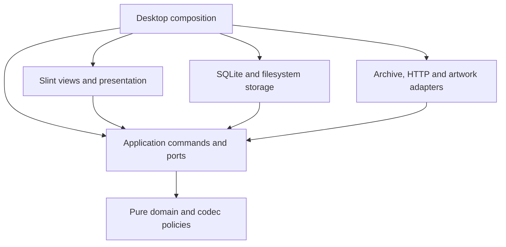

# Rust native desktop architecture

Status: implemented on `rewrite-in-rust-native-desktop`; signed release and
runtime cutover remain gated. This records the implementation integrated through
[PR 69](https://github.com/01max/librairii/pull/69), rather than the earlier
Wails runtime described by [ADR 0001](0001-wails-rebuild-baseline.md).

## Runtime and composition

The product executable is `librairii-desktop`: Rust application/domain logic,
compiled Slint views, the Winit desktop backend, Skia rendering and bundled
SQLite. Product windows, menus and the event loop belong to the main thread.
SQLite, archive inspection, hashing/copying, networking and artwork decoding run
through owned background work. Typed commands and coalesced snapshots connect
that work to presentation; the UI does not run SQL or perform custody effects
in paint callbacks.

There is no production HTML/JavaScript frontend, webview, loopback HTTP bridge,
Go service or application sidecar. Native C/C++ libraries and OS frameworks
remain part of the reviewed graph. A system portal or file manager used for a
native picker/reveal is an OS integration, not a second product runtime.

## Workspace boundaries

| Crate / directory | Responsibility |
| --- | --- |
| `librairii-core` | Effect-free typed identities, query/navigation codecs and import/export/tag/Collection/Shelf policies. |
| `librairii-app` | Typed use cases, job/lifecycle policies, ports, progress/outcomes and localization. It depends on core, not storage or a GUI toolkit. |
| `librairii-storage` | Bundled SQLite, repositories/migrations, library ownership, profiles, filesystem custody, backups, journals and recovery. |
| `librairii-adapters` | Bounded archive decoders, catalog HTTP/TLS, artwork/thumbnails, dates and native file identities. |
| `librairii-ui` | Compiled Slint views, pure presentation models, accessible state and bounded rich-text conversion. It cannot depend on storage/adapters. |
| `librairii-desktop` | Executable composition, worker/controller lifecycle, window/menu/picker/reveal adapters and view bindings. |
| `librairii-testkit` | Isolated synthetic roots, archives, identities, clocks/endpoints and failure fixtures; development dependencies only. |
| `xtask` and `scripts/` | Locked verification, preserved-source policy, focused analysis and native release/evidence orchestration. |

Workspace production dependencies point toward app/core; desktop composes the
effectful implementations. `cargo xtask check` enforces the allowed edges in
[`xtask/src/policy.rs`](../../xtask/src/policy.rs). Core has no SQLite, toolkit
or network dependency. Testkit does not become a production dependency.

The diagram summarizes the layer direction; UI, storage and adapters may also
use core types directly. The real Cargo manifests and boundary checker define
the complete dependency graph.

## Ownership, data and shutdown

One active library generation coordinates command intake, background work,
database/file ownership and root-dependent artwork. Stale query/generation
results do not update a replacement view or library. Work queues, progress
delivery, review/export preparations and visible models have explicit bounds;
terminal operation results remain durable in SQLite.

Startup inspects recovery state before ordinary mutation. The participating
Go bridge and Rust retain OS-backed ownership through recovery and resource
closure; a PID file is not authority. Native adoption uses a verified independent
copy with a separate native profile/recovery workspace unless lifetime exclusion
of unmodified legacy executables can be established. Go settings continue to
select the source. The supported route and rollback limits are documented in
the [transition guide](../native-transition.md).

The library retains its UUID, `db/librairii.sqlite3`, migrations 001–018,
archives, catalogs, staging, trash, logs and durable operation records. The
`wails-go-sqlite` schema-family string is a compatibility identity; it does not
load a Go runtime. Native language/UI preferences and relocation authority live
in independent profile storage outside the movable library.

Import/export publication, removal compensation, metadata activation and
relocation each retain their commit/recovery boundaries. Cancellation reports
already committed effects honestly. Closing the window stops intake, requests
safe cancellation, completes durable work, joins owned workers and closes
resources before process exit. Forced termination has separate restart recovery
tests; it is not a successful graceful shutdown.

## Rendering and OS integration

The reviewed graph pins Slint 1.18.1, Winit 0.30.13 and Skia 0.153.3, including
the recorded derivatives and notices in
[the native toolkit inventory](../../.config/native-toolkit.json). The selected
Slint royalty-free route retains its licence and the top-level AboutSlint
attribution. This is a directly rendered desktop interface rather than a claim
that every widget is supplied by the OS.

The native views preserve the browsing/inspection and approved-member/review
hierarchy recorded in [the native reference inventory](../rewrite/native-reference.json).
English/French application text, accessible names and menu updates use the
native presentation layer. OS-owned controls follow the OS. Historical DOM/CSS
screenshots remain reference material, not native pixel-equivalence assertions.

macOS uses AppKit menu/edit/window services, native pickers and Finder through
the system `open` command. Linux uses XDG portals for file selection, GIO for
file-manager reveal and matching X11 `WM_CLASS`/Wayland `app_id` desktop identity.
The installed entry is `io.github.librairii.native.desktop`. Argument arrays
preserve native paths without interpolating them into a shell.

The default Skia route uses the system graphics stack;
`SLINT_BACKEND=winit-skia-software` selects the qualified CPU route. Linux
acceptance exercises X11 and Wayland, actual picker/file-manager behavior and
Orca output. macOS AX observations do not imply VoiceOver execution, which was
excluded from this change. Script-specific CJK/Arabic input/IME/shaping
qualification is deferred; valid UTF-8 data and filenames remain supported.

## Packages, evidence and retained history

Native release stages bind `VERSION`, source/tree, target, compiler graph,
shipping features, production profile, embedded assets and notices. Product
`--version`/`--build-info` return before profile or window startup; ordinary
development binaries do not contain qualifying release fingerprints.

The [platform matrix](../release-platforms.md) records the three tested native
baselines and required OS libraries. Installed acceptance runs the production
GUI with explicit isolated profiles/libraries and local fixtures. Its reports
bind the actual package checksum and observer source; headless tests and package
inspection do not substitute for the GUI or final signed bytes.

Developer ID signing, notarization/stapling, final signed-byte verification and
release promotion remain explicit gates. The retained Go/Wails/React code,
frozen fixtures, source history and compatibility checks remain until the
separate runtime-retirement review. Earlier architecture decisions and section
reports describe their recorded revisions; they do not override this runtime
description or turn an unverified candidate into a public release.

See [development commands](../development.md),
[CI policy](../rewrite/ci.md), [package orchestration](../rewrite/section-18.md),
[Collections/Shelves policy](0004-collections-and-shelves.md) and
[Lunii interoperability](0002-lunii-catalog-interoperability.md).
