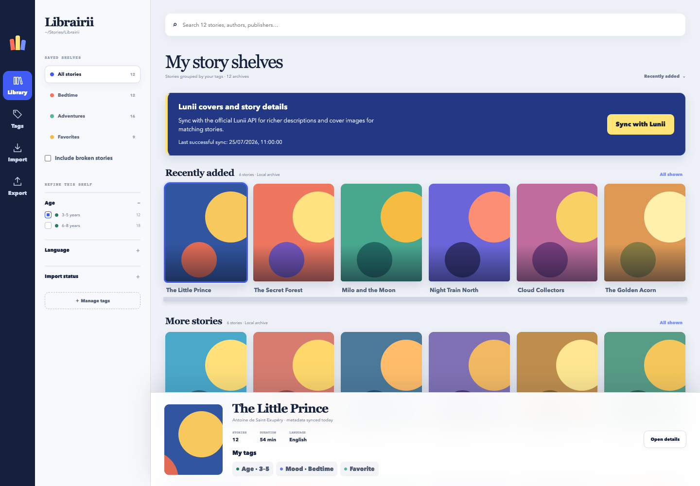
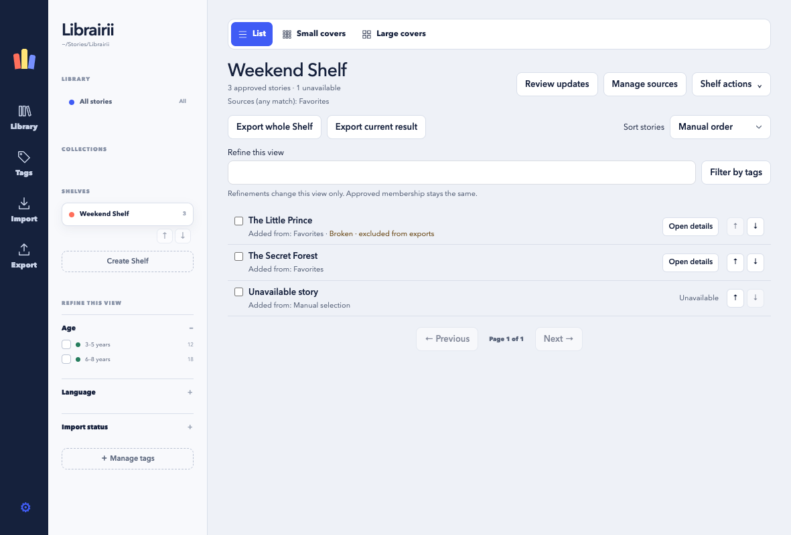
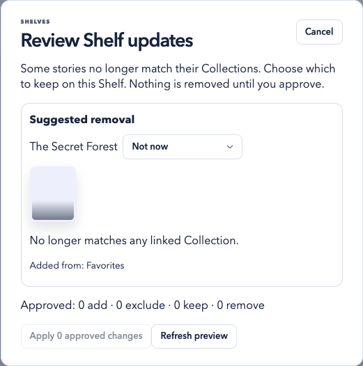
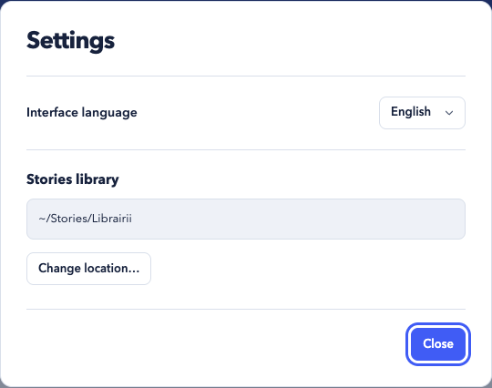

# Librairii user and recovery guide

Librairii keeps a private, local library of story archives. Importing creates a
managed copy; it never edits, renames, moves, or deletes the source file you
selected. This guide describes the current `main` implementation, whose version
is recorded in [`VERSION`](../VERSION) (currently `0.5.0`).

Screenshots use synthetic frontend fixtures and generated placeholder artwork.
See [how to refresh them](assets/README.md).

## Supported imports

The native import picker accepts these filename extensions:

- `.plain.pk`
- `.v1.pk`
- `.v2.pk`
- `.pk`
- `.zip`
- `.7z`

Librairii recognizes plain packs, v1/v2 packs, generic PK/ZIP archives, and
STUdio archives containing `story.json`. Equivalent STUdio and generic content
is supported in ZIP or 7z containers. An extension alone is not enough:
Librairii inspects required entries, paths, UUIDs, embedded metadata, and
artwork, and applies bounded entry-count, expanded-size, compression-ratio,
metadata, and image limits before publishing a managed copy.

An accepted archive is streamed into isolated staging, hashed with SHA-256,
and published under the application data root. The managed bytes are identical
to the selected source bytes. Importing the same checksum is idempotent. If
different bytes claim a UUID that is already active, the existing story and
archive stay authoritative and the conflicting source is not published.

Encrypted, malformed, unsafe, incomplete, or unsupported archives are rejected.
Librairii does not decrypt, repair, or convert story packs.

## Story details

Select a story and choose **Open details** to see its cover and description.
Descriptions display readable text and paragraph breaks, including when the
archive or catalog contains HTML. If artwork is unavailable, a colorful title
cover appears instead.

Assigned tags appear in the selected-story panel at every window size and in
the story details. Details open at the beginning of the description, including
when you reopen a long story. Click outside an application popup
to close it, or use its Close button or Escape key.

Choose **Edit tags** inside the story details popup to change assignments.
Closing the tag editor returns to the details with the current tags. The index
shows assigned tags without an edit action.

Choose **Show technical details** to inspect the story UUID, archive filename,
verification status, and full checksum. **Hide technical details** folds them
away again.

To remove a story, choose **Remove from library…**, then confirm with **Move to
trash**. **Keep story** returns to the story without removing it. The managed
copy moves to application trash; your original source file stays in place.

## Lunii covers and story details

**Sync with Lunii** contacts the official Lunii API to fetch contextual details
and cover images for matching stories. Before the first successful sync, a
prominent prompt appears above the shelves. The sync panel always shows the
last successful sync in your local date and time, including while an import or
another operation is running. A failed sync keeps the previous successful time
and the saved catalog available.

Close the Lunii panel with its × button to make more room for stories.
**Show Lunii sync** above the shelves reopens the panel without starting a sync.
Your choice is remembered when you close and reopen Librairii.

Shelf covers keep their image proportions, with the story title below the
image. Author and publisher information is available in the selected story's
details. The left rail provides labeled **Library**, **Tags**, **Import**, and
**Export** shortcuts: Library returns to all stories, Tags opens the tag
manager, Import opens the archive picker, and Export prepares the stories in
the current view.

Use **List**, **Small covers**, or **Large covers** above the shelves to choose
how stories appear. List shows titles and authors without cover images; the two
grids show covers at different sizes. Librairii remembers your choice. Switching
views keeps the current search, filters, sort order, and selected stories.

The application fits the window height. The navigation stays in place while
the story collection scrolls; long shelf and filter lists scroll independently
in their sidebar.
In a narrow window, choose **Library & filters** above the stories to open Collections,
Shelves, their management actions, and **Refine this view**. The panel scrolls
independently; choose **Done**, press Escape, or click outside to close it.

Broken stories remain visible and counted in the Library, Collections, Shelves,
and review proposals. A warning icon, **Broken** badge, and muted artwork identify
them. There is no built-in Broken visibility filter. Every export skips flagged
stories, including explicitly selected ones, and explains the skipped items.

Use the **Broken** switch in the selected story panel or in **Open details**.
For a bulk selection, the switch applies to all selected stories. In a Shelf,
select members to use its bulk switch, or open an available member's details.
Story cards retain their warning badge without extra action buttons. The change
notice and **Undo** appear only after a toggle; closing details clears its notice.

Flagging leaves cards, selections, counts, pagination, and focus in place.
**Undo** restores the previous flags only for stories actually changed, including
mixed bulk selections. If a story was removed or a flag changed again, Undo
reports a conflict without partially restoring the selection.

Broken is a manual flag, separate from validation and tags. Clearing it does not
repair archive bytes or certify playback. Upgrades preserve old built-in Broken
assignments as flags. Supported older saved queries and URLs deliberately lose
built-in flag restrictions, including nested ones, while keeping other criteria.
This can broaden old queries. Ordinary user tags named broken keep their normal
tag behavior, including reused tag IDs. Unsupported queries remain repairable.

Age tags start green. **Manage tags** lets you change the color of any tag,
including protected derived tags. Their names and system-managed
values stay protected, and chosen colors survive later metadata syncs.

## Export passthrough and Lunii.QT

An export can snapshot any of these scopes:

- the explicit story selection;
- every result in the current query, not only the visible page;
- one dynamic Collection or approved Shelf; or
- a deduplicated union of several Collections or several Shelves.

The story drawer shows **Export selected stories** only when multiple stories
are selected. For a single Library story, export the current result or its
Collection. A Shelf offers **Export whole Shelf**, **Export current result**
(with view-only refinements), and **Export selection** separately. Checkboxes in
the Shelves section offer a deduplicated export of the selected Shelves.

The preflight includes every intended UUID. Broken stories and unavailable Shelf
members appear as skipped, with their title/UUID and reason. Skips reserve no
filename or export bytes. A scope with no eligible stories cannot start. Pending
Shelf suggestions are never included. Flag changes before starting require a
fresh preview; later queued items are checked again immediately before copying.
Flagging a story already being copied does not retract that copy or earlier files.

Before copying, Librairii reevaluates the scope and checks each managed archive,
its checksum and validation state, its extension, the destination, and filename
conflicts. Exports preserve the original filename, supported extension, and
archive bytes. They do not add a manifest, decrypt, rewrite, transcode, or
otherwise mutate a pack. Destination-local temporary files are published
atomically and existing files are never overwritten. Cancellation removes
unfinished temporary files but retains exports that were already completed.

Finished import, sync, and export notices have a × button. Closing a notice
keeps it hidden after restarting the app without cancelling an operation or
deleting exported files. New operations still show their own progress and results.

If all destination filenames already exist, preflight explains the filename
conflicts. Use **Choose another folder** to retry the same export scope in a
different destination. Cancelling the picker keeps the current preflight open.

The resulting files are intended to remain selectable or draggable into
Lunii.QT's supported import flow. This is archive passthrough interoperability,
not a promise that Lunii.QT will accept every structurally valid archive or
that every archive works with every device or firmware version. Librairii does
not discover, pair with, update, or transfer files directly to a storyteller
device.

## Activity history

Choose **History** above the shelves to revisit imports, Lunii syncs, and exports,
including reports you closed and activity from previous app sessions. Expand an
entry to inspect item outcomes; completed exports retain **Reveal destination**.
Dates use your local time. **Load older activity** shows earlier records, and
**Refresh history** reloads the latest activity. Closing History leaves dismissed
notices hidden. Use Close, Escape, or click outside to return to the collection.

## Search, Collections, and Shelves

| Organize with… | Membership | Export contents |
| --- | --- | --- |
| **Collection** | Current matches for a saved search and filters | Current matches, with ineligible stories skipped |
| **Shelf** | Stories you explicitly approve | Approved members, with ineligible stories skipped; pending suggestions are excluded |

Name search is a literal, case-insensitive, accent-insensitive substring match
against the displayed title. `%` and `_` have no wildcard meaning. Name,
language, archive compatibility, boolean tags, choice tags, and supported
derived metadata filters combine as follows:

- values inside one choice definition use OR;
- separate filter groups use AND;
- a boolean filter requires assigned, requires unassigned, or is ignored.

Choose **Filter by tags** beside search to find tags and combine them with the
text query. Boolean tags offer **Tagged**, **Not tagged**, or **Any**; choice tags
allow multiple values. **Clear tag filters** keeps your search text. This picker
also refines Shelf views without changing approved membership. Spaces and letter
case stay intact while you type; matching still uses the normalized query.

The query hash and typed navigation history restore the active Library,
Collection, or Shelf when reloading or moving back and forward. Collection and
Shelf identities stay separate even when their numeric IDs are the same.
**All stories** clears the active name and tag refinements. Collapsing a filter
heading keeps its criteria selected.

Collections are dynamic saved searches. Existing saved Shelves become Collections
with their names, order, IDs, and supported non-Broken criteria preserved.
They reevaluate after library or metadata changes. An empty query means all
active stories. Broken flags affect neither matching nor counts. Missing tag
criteria require repair; they never become an unfiltered query silently.

Select Collections and choose **Save current query** to save a copied OR query:
a story matching any selected Collection appears once. Later edits or deletion
of the original Collections do not modify that copied query. Collection exports
use current matches and deduplicate overlaps.

Shelves retain approved story UUIDs. **Create Shelf** opens an explicit initial
preview; choose the stories and confirm **Create with N stories**. A new empty
Shelf is valid. **Add to Shelf…** in the selected-story panel adds chosen stories
to an existing Shelf or previews a new Shelf from the selection. Manual additions
stay on the Shelf until you explicitly remove them and clear any prior exclusion
for that UUID. There is no protection setting: every approved story remains in
place until you approve its removal.

Shelf search, sidebar refinements, and sorting change the view only. They never
replace approved membership or create source rules. Manual-order arrow buttons
explicitly reorder members; Rename, Duplicate, and Delete operate on that Shelf.
A duplicate retains approved membership, manual keep decisions, exclusions, and
source attribution independently; it accepts no fresh source matches.

**Manage sources** links Collections with the meaning “matches any of these
Collections.” Linking never adds stories automatically. **Review updates** shows
current additions and source-derived removals; every decision initially says
**Not now**. **Add** approves membership, **Exclude from suggestions** records a
persistent exclusion, **Keep** retains a story as a manual choice, and
**Remove and exclude** removes membership and suppresses future suggestions.
Bulk actions are explicit too. Review the final action totals before applying.
Deferring or cancelling changes nothing. Expired or stale reviews require a
fresh preview and renewed decisions.

Current matching sources explain additions; **Added from** records historical
acceptance, including detached sources. Manually added or explicitly kept stories
and unavailable UUIDs are never suggested for removal. If any source needs
attention or cannot evaluate, healthy sources may still suggest additions but all source removals pause.
The review says **Review incomplete** rather than **Up to date**.

When you open a Shelf with source-derived stories that no longer match any linked
Collection, a prompt opens for those stories. Choose **Keep**, **Remove and
exclude**, or **Not now**, then apply the decisions you approved. Closing the
review changes nothing; **Review updates** lets you return to deferred decisions.
**Keep** makes retention a manual choice, so the same mismatch does not keep
prompting. Manual-only Shelves do not receive source-removal prompts.
**Shelf actions → Manage exclusions** can allow suggestions again without adding
the story. **Remove selected** only removes approved membership; the story can
appear in a later Collection diff and be added again. **Exclude from suggestions**
and **Remove and exclude** are the separate choices that suppress suggestions.
Library archives remain unchanged.

Earlier removals may already have created exclusions. **Review updates** shows
an excluded-story count with a direct **Manage exclusions** action. Choose
**Allow suggestions for…** to make that story eligible for the next diff again.

Detaching sources previews affected members. Explicitly **Keep all and apply
sources**, or decide Keep/Remove for every affected story before applying. Removal
is disabled when source coverage is uncertain or a story is unavailable. Removing
the last source retains every kept member as a manual choice. Deleting a linked
Collection reviews all affected Shelves and commits their approved decisions together with
the deletion. Cancelling leaves both Collections and Shelves unchanged.

Library removal leaves Shelf membership, exclusions, and acceptance origins
intact. Missing members show **Unavailable**, with cached title and UUID; importing
the same UUID reconnects membership even when its internal database ID changes.
Shelves are local curation, without filesystem synchronization or manifests.

## Application data, trash, and recovery

The proposed default library root is:

| Platform | Location |
| --- | --- |
| macOS | `~/Library/Application Support/Librairii` |
| Linux | `$XDG_DATA_HOME/librairii`, or `~/.local/share/librairii` when `XDG_DATA_HOME` is unset |

A chosen library location is remembered in Settings. Development and test commands may select a different absolute root with
`LIBRAIRII_DATA_ROOT`. A production library contains:

| Path | Purpose |
| --- | --- |
| `db/librairii.sqlite3` | stories, archive custody, tags, Collections, Shelves, metadata state, and operation history |
| `archives/` | content-addressed managed archive copies |
| `catalog/` | validated official-metadata snapshots and cached artwork |
| `staging/` | incomplete local operations; abandoned entries are cleaned during startup recovery |
| `trash/` | managed archives removed from the active library |
| `logs/` | bounded local diagnostic logs |

Removing a story first moves its managed archive to
`trash/removals/<operation-id>/`, then removes the active database record.
Librairii trash is not the operating system trash, and this release has no
in-app restore or empty-trash command. To recover an archive, quit Librairii,
copy the archive from `trash/` to a normal folder outside the application data
root, restart Librairii, and import that copy. Reimporting recreates the story
from archive/official metadata; manual tag assignments that were deleted with
the old story record are not restored.

For a complete backup, quit Librairii and copy the entire application data root.
Keep the database, `archives/`, and `catalog/` together. Do not edit the SQLite
database or move files directly into `archives/`.

Before applying a pending database migration, Librairii creates a protected
SQLite snapshot beside the live database named like
`librairii.pre-migration-vNNN-….sqlite3`. A failed migration automatically
restores that snapshot and never deletes managed archive bytes. If the expected
database path contains an unrelated or legacy schema, mutations remain disabled
until the recovery screen's **Preserve database and create new library** action
moves the database and any WAL/SHM sidecars into a unique
`db/schema-conflict-recovery-*` directory. Nothing in that directory is
overwritten. If preservation cannot be completed, Librairii keeps mutations
disabled and does not silently initialize over the conflicting files.

A downgrade after a successful Collections/Shelves upgrade requires quitting the
app and restoring the matching pre-upgrade backup (preferably the complete
library root) with the older application version. Preserve a copy of the current
root first. An older binary cannot interpret the new curated decisions, and
there is no reverse migration that merges them into dynamic saved queries.

Uninstalling the application bundle does not delete the application data root.
Delete that root separately only when you intend to permanently erase the
library, managed archives, catalog cache, trash, logs, and recovery files.

## Official metadata and provenance

An explicit metadata refresh obtains a bounded guest token and downloads the
official pack catalog. Librairii validates and stages the complete response
before atomically activating it. A failed, cancelled, corrupt, timed-out, or
offline refresh leaves the last-known-good snapshot active.

Only complete archive UUIDs are matched. For display fields, active official
metadata prefers the configured locale, then an available translation of the
same language, then another available official translation. Permitted embedded
metadata and a deterministic UUID fallback follow. The detail UI exposes source and
freshness information such as locale, publisher, source record, source update,
fetch, and activation timestamps when the catalog provides them. Missing or
ambiguous age data is left unassigned; unambiguous ages produce read-only
derived facets.

Refreshing official metadata can change display text, artwork, derived facets,
search results, and dynamic Collection matches and Shelf suggestions. It never changes user-created
tag definitions, manual tag assignments, Collection definitions and approved Shelf membership, archive
bytes, or manual broken flags.

## Privacy and network behavior

Import, inspection, organization, search, shelves, export, removal, and local
recovery run entirely on the device. Librairii has no personal sign-in path and
does not request or store a username, password, account cookie, personal token,
device key, firmware, story archive, or user-library data from Lunii services.

The official metadata adapter is the only product path that contacts the
network. An explicit refresh uses HTTPS (TLS 1.2 minimum) to request a guest
token and the public pack catalog from the configured Lunii endpoints.
Referenced official artwork is fetched lazily from its allowlisted HTTPS origin
when the UI needs it, then validated and cached. Requests have time and byte
limits and do not follow redirects. There is no scheduled background catalog
refresh and no archive upload.

Diagnostic exports exclude archive bytes, guest tokens, absolute private paths,
catalog artwork, and other sensitive local data.

## Attribution and independence

Librairii is an independent project and is not affiliated with or endorsed by
Lunii SAS or the Lunii.QT maintainers. Product and project names are used only
to describe archive and workflow interoperability.

The guest-token envelope, catalog protocol details, and supported passthrough
workflow were independently reimplemented from observable behavior in
[Lunii.QT](https://github.com/o-daneel/Lunii.QT) at tree
`c8afe43dde21c2be33c0667ced962dc023eb948a`. Lunii.QT is licensed under
GPL-3.0. Librairii contains no copied Lunii.QT source code or copyrighted
catalog dataset. The detailed technical boundary is recorded in
[the Lunii catalog interoperability decision](architecture/0002-lunii-catalog-interoperability.md).

## Settings, interface language, and library location

Open **Librairii → Settings…** (or **⌘,**) on macOS. On Linux use the
application menu or the gear button in the app. The settings panel is also
available when the library needs recovery.

Choose **Français** or **English** for the interface. Your explicit choice is
remembered and applies immediately. On first launch, French is selected for a
French system language; other system languages default to English. This setting
changes interface text and formatting. Story titles, descriptions, custom tag
labels, and Collection/Shelf names keep their existing text. Lunii metadata fetching and
its existing locale policy remain unchanged.

A new installation asks you to confirm where the library will live before
creating it. You can accept the proposed platform default or choose a different
empty folder using the native picker. The selected folder itself becomes the
library root. Upgrading an existing installation keeps its current library in
place automatically.

To move the library, choose **Change location…**, select an empty folder, review
the destination and total size, and choose **Move library**. Wait for imports,
exports, and syncs to finish before starting a move. The move includes the
database, story archives, tags, Collections, Shelves, history, covers, catalog snapshots,
staging, trash, diagnostic logs, and database recovery files. Original source
archives and previously exported files outside the library remain in place.
Another library or a nonempty destination cannot be merged or overwritten.

Moving requires temporary free space approximately equal to the complete
library. Progress is shown while copying and verifying. You can cancel before
the new location is committed. The original library stays authoritative until
the copied files and database have been verified and the new location saved.
After an interruption, restart Librairii to reconcile the move. A pending
cleanup notice means the new location is active but old files remain at the
reported path; changed or newly added files are preserved. Keep backups and
inspect that old location before removing retained files manually.

If a drive is disconnected or the saved folder is missing, Librairii does not
create an empty replacement. Open Settings, reconnect the drive and choose
**Try again**, or choose **Locate library…** to identify the same library at a
new path. A different library is rejected. A normal backup still requires
quitting the application and copying the complete library root.

Preferences and relocation recovery records are stored separately from the
movable library:

| Platform | Configuration directory |
| --- | --- |
| macOS | `~/Library/Preferences/io.github.librairii.app/` |
| Linux | `$XDG_CONFIG_HOME/librairii/`, or `~/.config/librairii/` |

Include that configuration directory in a full application backup. A corrupt or
unsupported settings file enters recovery instead of silently resetting the
library. The `LIBRAIRII_DATA_ROOT` developer/test override bypasses onboarding,
uses isolated settings, and disables relocation; it never reads or updates the
normal production profile.

Older application versions do not read the new library-location setting.
Before downgrading, quit Librairii and restore the complete current library to
the previous version's default location from a verified backup. Never launch
an older version while relocation is incomplete.
