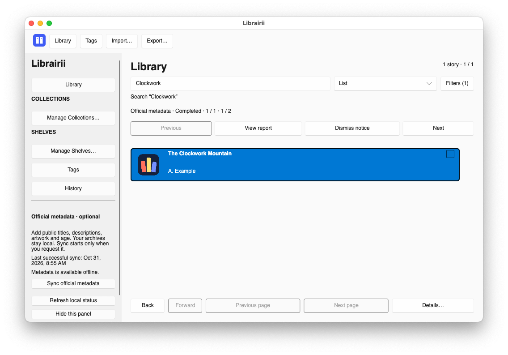
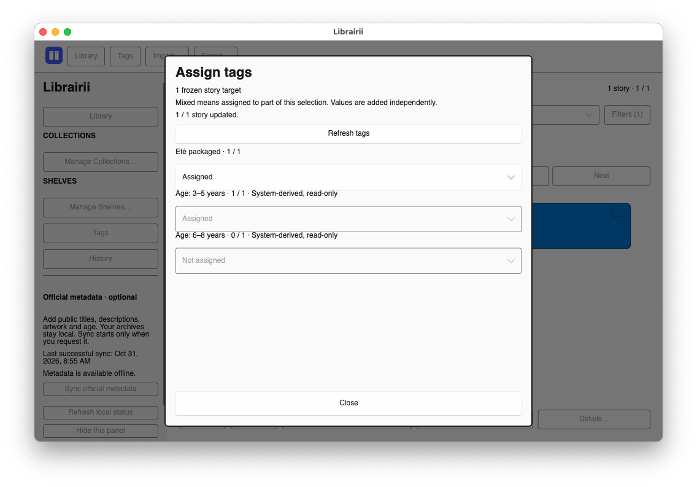
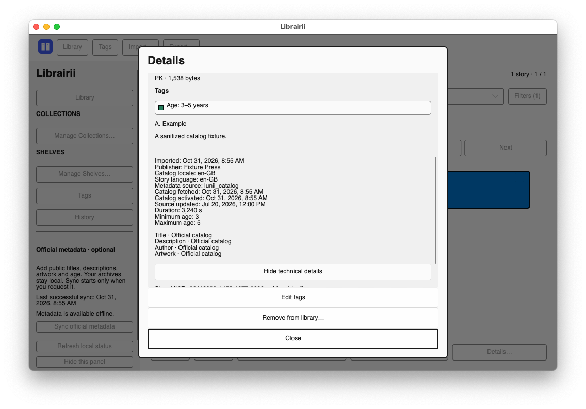
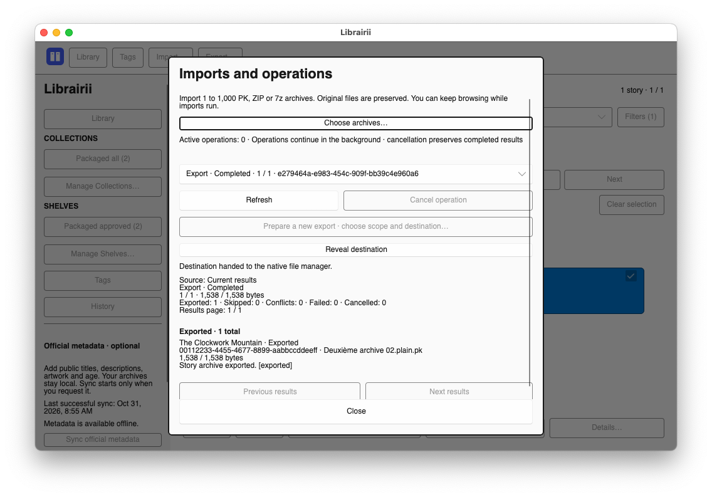
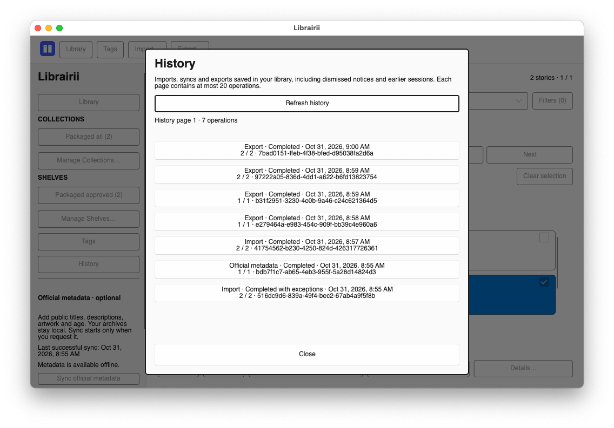
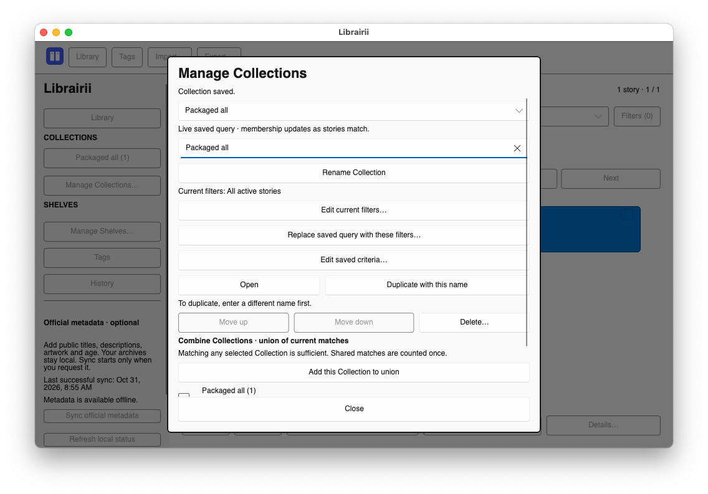
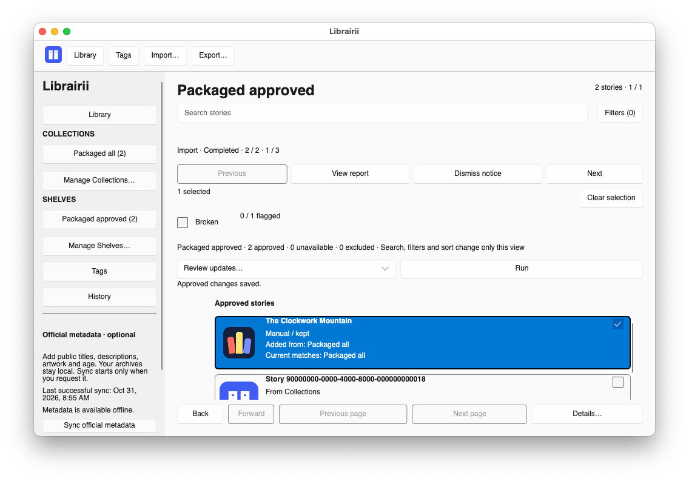
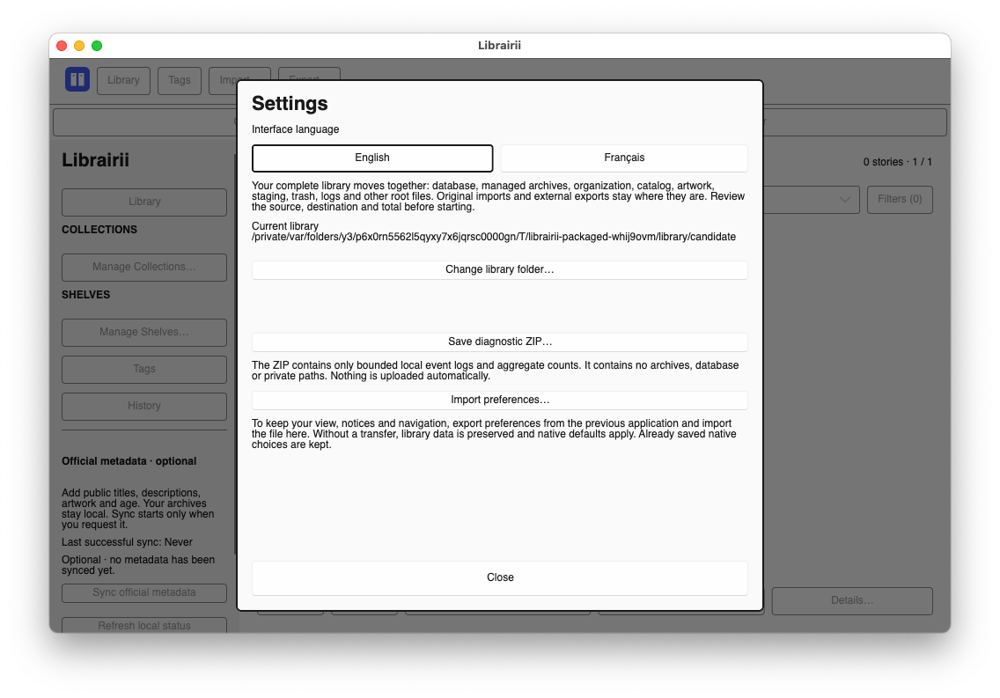

# Librairii user and recovery guide

Librairii keeps a private, local library of story archives. Importing creates a
managed copy; it never edits, renames, moves or deletes your selected source.
This guide describes the Rust native candidate on
`rewrite-in-rust-native-desktop`. See the [platform matrix](release-platforms.md)
for installation requirements and remaining public Mac signing gates. For an
existing Go library, follow the [transition guide](native-transition.md) first.

These are actual native macOS windows captured in isolated packaged CI with
synthetic archives and a loopback metadata fixture. They contain no personal
library or live Lunii data. [Capture provenance](assets/README.md) records source,
package and image checksums. Linux uses the same application controls with its
own system menus, pickers and file manager.

## Getting around

The top bar provides **Library**, **Tags**, **Import…** and **Export…**. The left
navigation holds Collections, Shelves, **History**, optional metadata sync and
**Settings…**; scroll it to reach lower controls. In a narrow window, choose
**Navigation**, then **Close navigation** or Escape to return to stories.
Story lists and dialog contents scroll independently. Use Tab/Shift-Tab to move
between controls, Enter/Space to activate them, and Escape or **Close** to leave
an application dialog. System file pickers follow the operating system.

Select a story for inspection; its checkbox adds it to the explicit bulk
selection. **Clear selection** clears those checkboxes. **Details…** opens the
selected story, including when the side inspector is hidden.

## Supported imports

Choose **Import…**, then **Choose archives…** for up to 1,000 files per batch.
You can keep browsing while operations run. The native picker accepts:

- `.plain.pk`
- `.v1.pk`
- `.v2.pk`
- `.pk`
- `.zip`
- `.7z`

Librairii recognizes plain packs, v1/v2 packs, generic PK/ZIP archives, and
STUdio archives containing `story.json`. Equivalent STUdio and generic content
is supported in ZIP or 7z containers. An extension alone is not enough:
Librairii inspects required entries, paths, UUIDs, embedded metadata, and
artwork, and applies bounded entry-count, expanded-size, compression-ratio,
metadata, and image limits before publishing a managed copy.

An accepted archive is streamed into isolated staging, hashed with SHA-256,
and published under the application data root. The managed bytes are identical
to the selected source bytes. Importing the same checksum is idempotent. If
different bytes claim a UUID that is already active, the existing story and
archive stay authoritative and the conflicting source is not published.

Encrypted, malformed, unsafe, incomplete, or unsupported archives are rejected.
Librairii does not decrypt, repair, or convert story packs.

## Story details

Select a story and choose **Details…** to see its cover and description.
Descriptions display readable text and paragraph breaks, including when the
archive or catalog contains HTML. If artwork is unavailable, a colorful title
cover appears instead.

Assigned tags appear in the selected-story panel at every window size and in
the story details. Details open at the beginning of the description, including
when you reopen a long story. Use **Close** or Escape to close an application dialog.

Choose **Edit tags** inside story details to change assignments.
Closing the tag editor returns to the details with the current tags. The index
shows assigned tags without an edit action. Bulk assignment uses frozen targets;
**Mixed · leave unchanged** means only part of the selection has that tag.
Choice values are added independently.

Choose **Show technical details** to inspect the story UUID, archive filename,
verification status, and full checksum. **Hide technical details** folds them
away again.

To remove a story, choose **Remove from library…**, then confirm with **Move to
trash**. **Keep story** returns to the story without removing it. The managed
copy moves to application trash; your original source file stays in place.

## Lunii covers and story details

**Sync official metadata** contacts the official Lunii API to fetch contextual details
and cover images for matching stories. Before the first successful sync, a
optional prompt also offers **Later**. The sync panel always shows the
last successful sync in your local date and time, including while an import or
another operation is running. A failed sync keeps the previous successful time
and the saved catalog available.

Choose **Hide this panel** in navigation to make more room.
**Show metadata sync** reopens it without starting a sync. **Refresh local
status** reads saved state without a network refresh.
Your choice is remembered when you close and reopen Librairii.

Covers keep their image proportions. Author and publisher information appears
in details. Use **List**, **Small covers** or **Large covers** in the presentation
selector. The choice is remembered without changing query, filters, sort or
selection. Collections, Shelves and their management controls stay in navigation;
filters open separately through **Filters…**.

Broken stories remain visible and counted in the Library, Collections, Shelves,
and review proposals. A warning icon, **Broken** badge, and muted artwork identify
them. There is no built-in Broken visibility filter. Every export skips flagged
stories, including explicitly selected ones, and explains the skipped items.

Use the **Broken** switch in the selected story panel or in **Details…**.
For a bulk selection, the switch applies to all selected stories. In a Shelf,
select members to use its bulk switch, or open an available member's details.
Story cards retain their warning badge without extra action buttons. The change
notice and **Undo** appear only after a toggle; closing details clears its notice.

Flagging leaves cards, selections, counts, pagination, and focus in place.
**Undo** restores the previous flags only for stories actually changed, including
mixed bulk selections. If a story was removed or a flag changed again, Undo
reports a conflict without partially restoring the selection.

Broken is a manual flag, separate from validation and tags. Clearing it does not
repair archive bytes or certify playback. Upgrades preserve old built-in Broken
assignments as flags. Supported older saved queries and URLs deliberately lose
built-in flag restrictions, including nested ones, while keeping other criteria.
This can broaden old queries. Ordinary user tags named broken keep their normal
tag behavior, including reused tag IDs. Unsupported queries remain repairable.

Age tags start green. **Tags** opens the manager to change the color of any tag,
including protected derived tags. Their names and system-managed
values stay protected, and chosen colors survive later metadata syncs.

## Export passthrough and Lunii.QT

An export can snapshot any of these scopes:

- the explicit story selection;
- every result in the current query, not only the visible page;
- one dynamic Collection or approved Shelf; or
- a deduplicated union of several Collections or several Shelves.

Choose **Export…**, then its **Export scope** selector:

- **Current results · all pages** includes a query or refined Shelf view beyond
  the visible page;
- **Selected stories** snapshots the explicit checkbox selection;
- **One or more Collections** reevaluates and deduplicates their union;
- **One or more approved Shelves** includes approved members independently of
  temporary filters or pending suggestions.

Choose groups where applicable and **Choose destination…**. Review the preview,
then **Export eligible archives**. A single checked story is a valid selection.

The preflight includes every intended UUID. Broken stories and unavailable Shelf
members appear as skipped, with their title/UUID and reason. Skips reserve no
filename or export bytes. A scope with no eligible stories cannot start. Pending
Shelf suggestions are never included. Flag changes before starting require a
fresh preview; later queued items are checked again immediately before copying.
Flagging a story already being copied does not retract that copy or earlier files.

Before copying, Librairii reevaluates the scope and checks each managed archive,
its checksum and validation state, its extension, the destination, and filename
conflicts. Exports preserve the original filename, supported extension, and
archive bytes. They do not add a manifest, decrypt, rewrite, transcode, or
otherwise mutate a pack. Destination-local temporary files are published
atomically and existing files are never overwritten. Cancellation removes
unfinished temporary files but retains exports that were already completed.

Finished import, sync and export notices offer **View report** and **Dismiss
notice**. Dismissing a notice
keeps it hidden after restarting the app without cancelling an operation or
deleting exported files. New operations still show their own progress and results.

If all destination filenames already exist, preflight explains the filename
conflicts. Use **Choose another destination…** to retry the same export scope in a
different destination. Cancelling the picker keeps the current preflight open.
**Refresh preview** reevaluates it.

The resulting files are intended to remain selectable or draggable into
Lunii.QT's supported import flow. This is archive passthrough interoperability,
not a promise that Lunii.QT will accept every structurally valid archive or
that every archive works with every device or firmware version. Librairii does
not discover, pair with, update, or transfer files directly to a storyteller
device.

## Activity history

Choose **History** in navigation to revisit imports, Lunii syncs, and exports,
including reports you closed and activity from previous app sessions. Select an
entry to inspect item outcomes; completed exports retain **Reveal destination**.
Dates use your local time. Each page contains at most 20 operations. **Load older activity** shows earlier records, and
**Refresh history** reloads the latest activity. Closing History leaves dismissed
notices hidden. Use **Close** or Escape to return to the collection.

## Search, Collections, and Shelves

| Organize with… | Membership | Export contents |
| --- | --- | --- |
| **Collection** | Current matches for a saved search and filters | Current matches, with ineligible stories skipped |
| **Shelf** | Stories you explicitly approve | Approved members, with ineligible stories skipped; pending suggestions are excluded |

Name search is a literal, case-insensitive, accent-insensitive substring match
against the displayed title. `%` and `_` have no wildcard meaning. Name,
language, archive compatibility, boolean tags, choice tags, and supported
derived metadata filters combine as follows:

- values inside one choice definition use OR;
- separate filter groups use AND;
- a boolean filter requires assigned, requires unassigned, or is ignored.

Choose **Filters…** beside search to find tags and combine them with the
text query. Boolean tags offer **Tagged**, **Not tagged**, or **Any**; choice tags
allow multiple values. **Clear tag filters** keeps your search text. This picker
also refines Shelf views without changing approved membership. Spaces and letter
case stay intact while you type; matching still uses the normalized query.

**Back** and **Forward** navigate semantic Library, Collection and Shelf views.
Saved native navigation restores the view on reopening. Collection and Shelf
identities stay separate even when numeric IDs coincide. **Clear all** in Filters
clears active refinements. Collapsing a heading keeps its criteria selected.

Collections are dynamic saved searches. Existing saved Shelves become Collections
with their names, order, IDs, and supported non-Broken criteria preserved.
They reevaluate after library or metadata changes. An empty query means all
active stories. Broken flags affect neither matching nor counts. Missing tag
criteria require repair; they never become an unfiltered query silently.

Open **Manage Collections…** to create, rename, reorder, duplicate, repair or
delete a saved search. **Save current filters as Collection** snapshots criteria;
**Replace saved query with these filters…** requires confirmation. Its **Combine
Collections** controls open a deduplicated union or save a copied OR query as
a new Collection. Later source edits/deletion do not alter the copy.

Shelves retain approved UUIDs. In **Manage Shelves…**, select a new Shelf, name
it, choose initial candidates from the story selection and/or linked Collections,
then **Preview initial members…** and confirm the explicit membership. An empty
Shelf is valid. For an existing Shelf, **Add these stories manually to the Shelf**
adds selected stories and clears their prior exclusions. Manual additions stay
until explicitly removed. Every approved member is retained until removal is
approved; there is no protection setting.

Shelf search, sidebar refinements, and sorting change the view only. They never
replace approved membership or create source rules. The **Shelf action** selector plus **Run** provides **Move member up/down**,
**Remove members…**, **Remove and exclude…**, **Manage exclusions…**,
**Restore approved view and order** and **Review updates…**. These member-order
commands change stored order. Rename, duplicate and delete are in the manager.
A duplicate retains approved membership, manual keep decisions, exclusions, and
source attribution independently; it accepts no fresh source matches.

The Sources controls in **Manage Shelves…**, followed by **Review source
changes…**, link Collections with the meaning “matches any of these
Collections.” Linking never adds stories automatically. **Review updates** shows
current additions and source-derived removals; every decision initially says
**Not now**. **Add** approves membership, **Exclude from suggestions** records a
persistent exclusion, **Keep** retains a story as a manual choice, and
**Remove and exclude** removes membership and suppresses future suggestions.
Bulk actions are explicit too. Review the final action totals before applying.
Deferring or cancelling changes nothing. Expired or stale reviews require a
fresh preview and renewed decisions.

Current matching sources explain additions; **Added from** records historical
acceptance, including detached sources. Manually added or explicitly kept stories
and unavailable UUIDs are never suggested for removal. If any source needs
attention or cannot evaluate, healthy sources may still suggest additions but all source removals pause.
The review says **Review incomplete** rather than **Up to date**.

When you open a Shelf with source-derived stories that no longer match any linked
Collection, a prompt opens for those stories. Choose **Keep**, **Remove and
exclude**, or **Not now**, then apply the decisions you approved. Closing the
review changes nothing; **Review updates** lets you return to deferred decisions.
**Keep** makes retention a manual choice, so the same mismatch does not keep
prompting. Manual-only Shelves do not receive source-removal prompts.
**Manage exclusions…** can allow suggestions again without adding
the story. **Remove members…** only removes approved membership; the story can
appear in a later Collection diff and be added again. **Exclude from suggestions**
and **Remove and exclude** are the separate choices that suppress suggestions.
Library archives remain unchanged.

Earlier removals may already have created exclusions. **Review updates** shows
an excluded-story count with a direct **Manage exclusions** action. Choose
**Allow suggestions** to make that story eligible for the next diff again.

Detaching sources previews affected members. Explicitly keep all and apply the
source changes, or decide Keep/Remove for every affected story before applying. Removal
is disabled when source coverage is uncertain or a story is unavailable. Removing
the last source retains every kept member as a manual choice. Deleting a linked
Collection reviews all affected Shelves and commits their approved decisions together with
the deletion. Cancelling leaves both Collections and Shelves unchanged.

Library removal leaves Shelf membership, exclusions, and acceptance origins
intact. Missing members show **Unavailable**, with cached title and UUID; importing
the same UUID reconnects membership even when its internal database ID changes.
Shelves are local curation, without filesystem synchronization or manifests.

## Application data, trash, and recovery

The proposed fresh native library root is separate from Go's:

| Platform | Location |
| --- | --- |
| macOS | `~/Library/Application Support/LibrairiiNative` |
| Linux | `$XDG_DATA_HOME/librairii-native`, or `~/.local/share/librairii-native` when `XDG_DATA_HOME` is unset |

The confirmed/chosen root is authoritative and can be elsewhere. Settings remembers
it. Developer overrides have separate restrictions in [development](development.md).
A production library contains:

| Path | Purpose |
| --- | --- |
| `db/librairii.sqlite3` | stories, archive custody, tags, Collections, Shelves, metadata state, and operation history |
| `archives/` | content-addressed managed archive copies |
| `catalog/` | validated official-metadata snapshots and cached artwork |
| `staging/` | incomplete work, recovered only within verified ownership |
| `trash/` | managed archives removed from the active library |
| `logs/` | bounded local diagnostic logs |
| Hidden markers and recovery records | library identity, native ownership and interrupted operations |

Removing a story first moves its managed archive to
`trash/removals/<operation-id>/`, then removes the active database record.
Librairii trash is not the operating system trash, and this release has no
in-app restore or empty-trash command. To recover an archive, quit Librairii,
copy the archive from `trash/` to a normal folder outside the application data
root, restart Librairii, and import that copy. Reimporting recreates the story
from archive/official metadata; manual tag assignments that were deleted with
the old story record are not restored. Existing Shelf UUID associations can
reconnect, but this does not restore the complete removed story record.

For a complete backup, quit Librairii and copy the **entire library root and
separate native profile/recovery directory** together, including hidden files,
journals and any SQLite sidecars. Keep original paths with the backup. A live
database-only copy is insufficient. Keep uncertain copies until recovery is
resolved. Do not edit the SQLite
database or move files directly into `archives/`.

Before applying a pending database migration, Librairii creates a protected
SQLite snapshot beside the live database named like
`librairii.pre-migration-vNNN-….sqlite3`. A failed migration automatically
restores that snapshot and never deletes managed archive bytes. If the expected
database has a supported historical schema, it migrates through the retained
prefixes. An unrelated foreign schema instead keeps mutations disabled. The
recovery screen offers **Preserve foreign database…**, followed by **Confirm
recovery** or **Keep files unchanged**. Confirmation preserves the database and
WAL/SHM sidecars in a unique `db/schema-conflict-recovery-*` directory, then
creates an empty database in the same library. Organization stored in the old
database will not appear in the empty database; managed archive files remain
unchanged. **Finish database recovery…** completes an interrupted verified
replacement while keeping the current compatible database. Nothing in the
preservation directory is overwritten. Failed preservation keeps mutations
disabled and does not silently replace conflicting files.

For Go rollback, cross-OS copying, filename conflicts and post-backup edits,
follow the [transition instructions](native-transition.md). Never route an old
Go executable to the native candidate or overwrite the only native copy.
Pre-migration database snapshots are recovery aids, not full-library backups
or reverse migrations.

Uninstalling/replacing the application retains the library and separate native
profile/recovery directory.
Delete that root separately only when you intend to permanently erase the
library, managed archives, catalog cache, trash, logs, and recovery files.

## Official metadata and provenance

An explicit metadata refresh obtains a bounded guest token and downloads the
official pack catalog. Librairii validates and stages the complete response
before atomically activating it. A failed, cancelled, corrupt, timed-out, or
offline refresh leaves the last-known-good snapshot active.

Only complete archive UUIDs are matched. For display fields, active official
metadata prefers the configured locale, then an available translation of the
same language, then another available official translation. Permitted embedded
metadata and a deterministic UUID fallback follow. The detail UI exposes source and
freshness information such as locale, publisher, source record, source update,
fetch, and activation timestamps when the catalog provides them. Missing or
ambiguous age data is left unassigned; unambiguous ages produce read-only
derived facets.

Refreshing official metadata can change display text, artwork, derived facets,
search results, and dynamic Collection matches and Shelf suggestions. It never changes user-created
tag definitions, manual tag assignments, Collection definitions and approved Shelf membership, archive
bytes, or manual broken flags.

## Privacy and network behavior

Import, inspection, organization, search, shelves, export, removal, and local
recovery run entirely on the device. Librairii has no personal sign-in path and
does not request or store a username, password, account cookie, personal token,
device key, firmware, story archive, or user-library data from Lunii services.

The official metadata adapter is the only product path that contacts the
network. An explicit refresh uses HTTPS (TLS 1.2 minimum) to request a guest
token and the public pack catalog from the configured Lunii endpoints.
Referenced official artwork is fetched lazily from its allowlisted HTTPS origin
when the UI needs it, then validated and cached. Requests have time and byte
limits and do not follow redirects. There is no scheduled background catalog
refresh and no archive upload.

**Settings… → Save diagnostic ZIP…** contains only bounded local event logs and
aggregate counts. It excludes the database, archive bytes, guest tokens, absolute
private paths and catalog artwork. Nothing is uploaded automatically.

## Attribution and independence

Librairii is an independent project and is not affiliated with or endorsed by
Lunii SAS or the Lunii.QT maintainers. Product and project names are used only
to describe archive and workflow interoperability.

The guest-token envelope, catalog protocol details, and supported passthrough
workflow were independently reimplemented from observable behavior in
[Lunii.QT](https://github.com/o-daneel/Lunii.QT) at tree
`c8afe43dde21c2be33c0667ced962dc023eb948a`. Lunii.QT is licensed under
GPL-3.0. Librairii contains no copied Lunii.QT source code or copyrighted
catalog dataset. The detailed technical boundary is recorded in
[the Lunii catalog interoperability decision](architecture/0002-lunii-catalog-interoperability.md).

## Settings, interface language, and library location

Open **Librairii → Settings…** (or **⌘,**) on macOS. On Linux use the
application menu or **Settings…** in navigation. The settings panel is also
available when the library needs recovery.

Choose **Français** or **English** for the interface. Your explicit choice is
remembered and applies immediately. On first launch, French is selected for a
French system language; other system languages default to English. This setting
changes interface text and formatting. Story titles, descriptions, custom tag
labels, and Collection/Shelf names keep their existing text. Lunii metadata fetching and
its locale policy remain unchanged. Application menus follow the saved interface
language; OS-controlled file pickers can follow the operating system's language.

A new installation asks you to confirm where the library will live before
creating it. You can accept the proposed platform default or choose a different
empty folder using the native picker. The selected folder itself becomes the
library root. For an existing Go installation, native startup instead requires a verified
**independent copy** into a different empty folder. It does not silently adopt
the Go source; follow the [transition guide](native-transition.md). Subsequent
native launches reopen their saved native library.

To move the library, choose **Change library folder…**, select an empty folder, review
the destination and total size, and choose **Move the complete library**. Wait for imports,
exports, and syncs to finish before starting a move. The move includes the
database, story archives, tags, Collections, Shelves, history, covers, catalog snapshots,
staging, trash, diagnostic logs, and database recovery files. Original source
archives and previously exported files outside the library remain in place.
Another library or a nonempty destination cannot be merged or overwritten.

Moving requires temporary free space approximately equal to the complete
library. Progress is shown while copying and verifying. You can cancel before
the new location is committed. The original library stays authoritative until
the copied files and database have been verified and the new location saved.
After an interruption, restart Librairii to reconcile the move. A pending
cleanup notice means the new location is active but old files remain at the
reported path; changed or newly added files are preserved. Keep backups and
inspect that old location before removing retained files manually.

If a drive is disconnected or the saved folder is missing, Librairii does not
create an empty replacement. Open Settings, reconnect the drive and choose
**Retry recovery**, or choose **Locate the same library…** to identify the same library at a
new path. A different library is rejected. A normal backup still requires
quitting the application and copying the complete library root.

Preferences and relocation recovery records are stored separately from the
movable library:

| Platform | Configuration directory |
| --- | --- |
| macOS | `~/Library/Preferences/io.github.librairii.native/` |
| Linux | `$XDG_CONFIG_HOME/librairii-native/`, or `~/.config/librairii-native/` |

Include the entire native configuration directory in a backup, with language,
binding, navigation/presentation, handover receipt and relocation recovery.
A corrupt or unsupported profile requires recovery instead of silently resetting.
Recovery may offer **Retry the verified move** or **Keep the source and unfinished
copy**; read which location remains authoritative. Imported Go journals do not
authorize native cleanup. Keep source, unfinished destination, profile and
journals; never delete locks, SQLite sidecars or control records to force opening.
Changed, unrelated and uncertain files are retained. Language stays changeable.

The [transition guide](native-transition.md) explains backups, preference import
and rollback to an original Go source or a separate pre-native backup. Do not
manually repoint legacy settings at native files. The developer/test override is
not a production adoption or recovery route.
